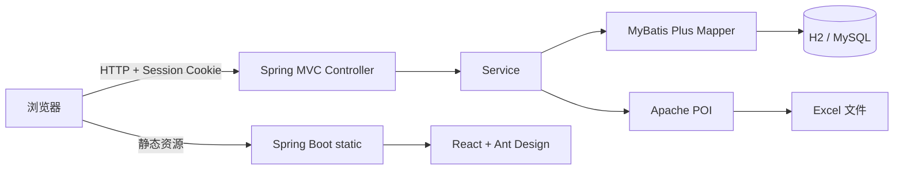
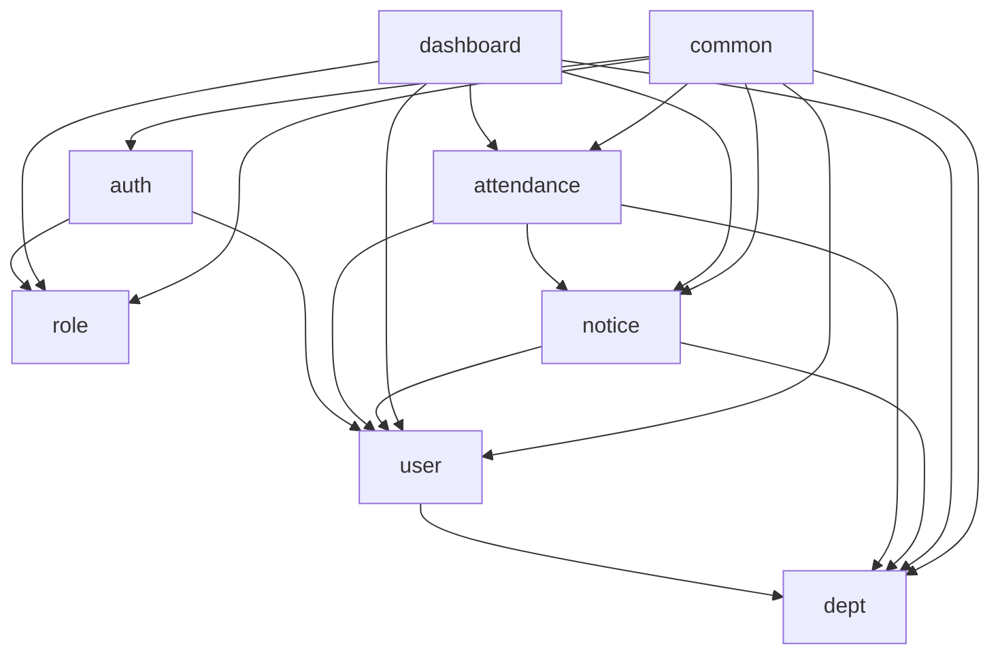
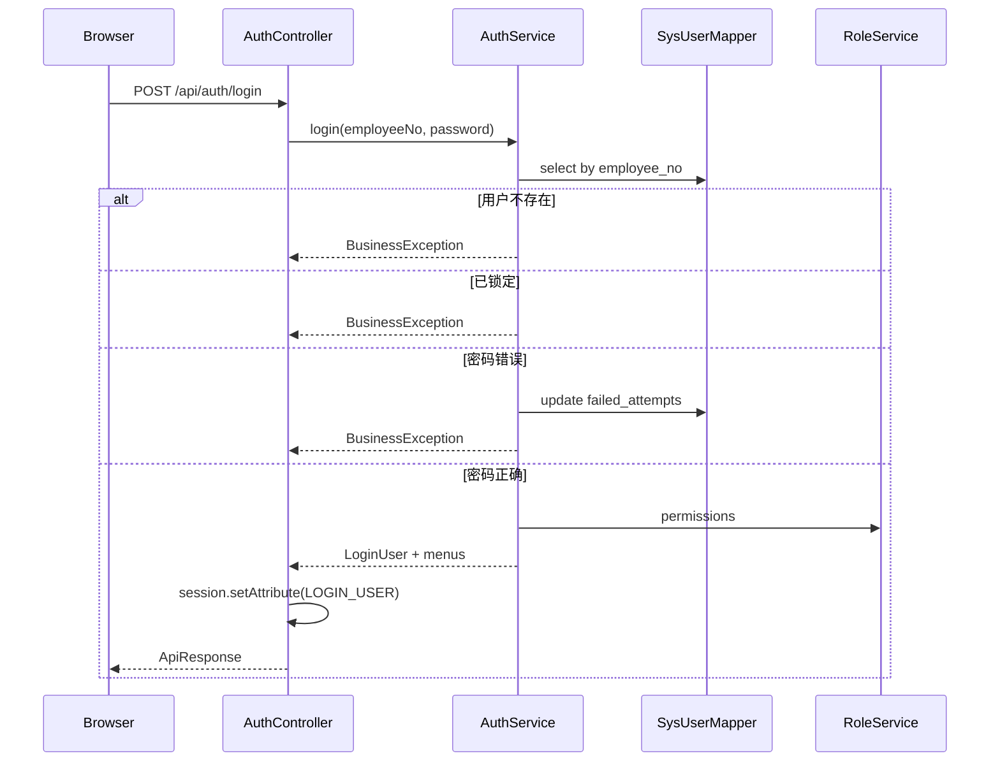
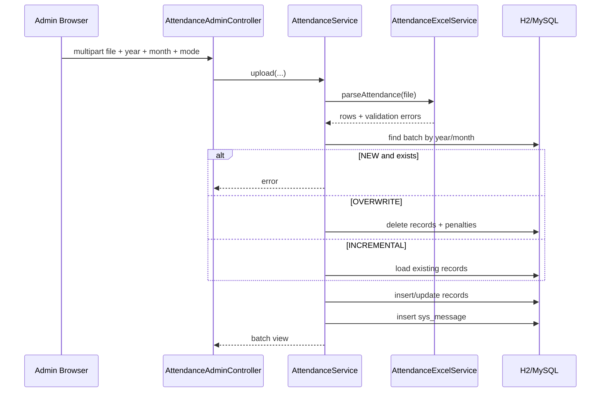
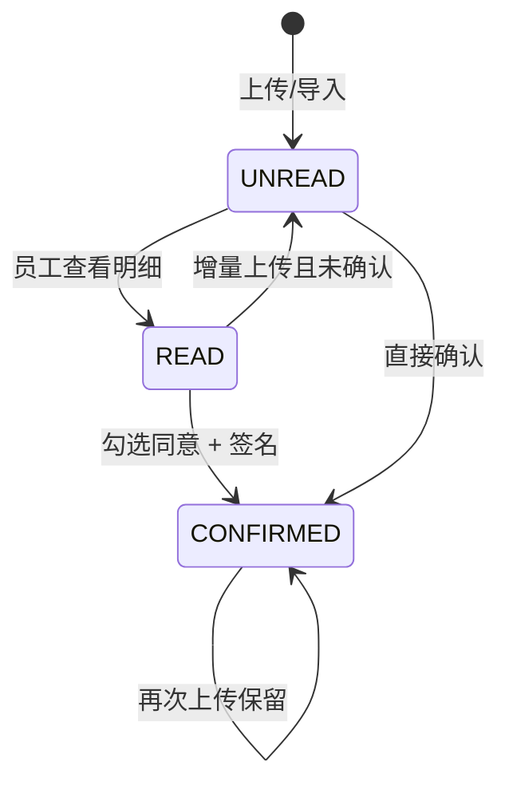
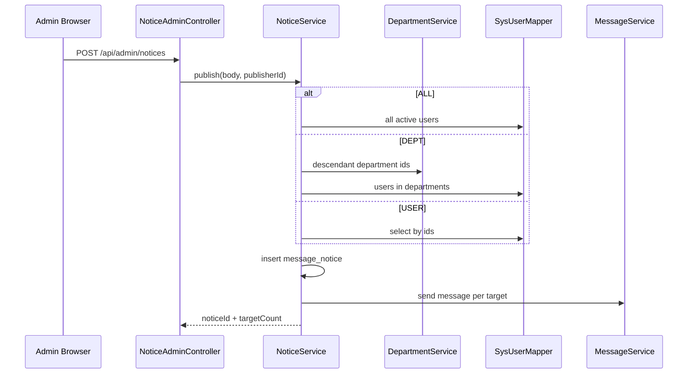

# 架构说明

## 1. 总览



前端和 API 同源部署. 开发时 Vite 代理 `/api` 到 Spring Boot.

## 2. 分层

| 层 | 位置 | 职责 |
|---|---|---|
| 前端 | `web/src` | React 页面, 表单, 表格, 签名画板 |
| 控制层 | `*/controller` | 参数接收, 权限入口, 返回 `ApiResponse` |
| 服务层 | `*/service` | 业务规则, 事务, 校验, 状态流转 |
| 数据层 | `*/mapper` | MyBatis Plus `BaseMapper` |
| 实体 | `*/entity` | 表映射 |
| 通用 | `common` | 响应, 异常, 拦截器, 菜单 |
| 配置 | `config` | 初始化数据, 分页, BCrypt |
| 前端构建 | `web` -> `src/main/resources/static` | 构建产物随 jar 发布 |

## 3. 模块



| 模块 | 说明 |
|---|---|
| auth | 登录, 登出, me, 修改密码 |
| user | 用户 CRUD, 个人资料 |
| dept | 部门树, 部门编码生成 |
| role | 角色, 菜单权限 |
| attendance | 批次, 明细, Excel, 异常, 签名, 提醒 |
| notice | 通知, 模板, 消息 |
| dashboard | 首页聚合统计 |
| common | ApiResponse, 异常, 拦截器, 菜单 |
| config | DataInitializer, MyBatis Plus, PasswordEncoder |

## 4. 登录流程



## 5. 考勤上传流程



## 6. 考勤状态机



## 7. 通知发布流程



## 8. 前端结构

```text
web/src/
  main.jsx          React 入口, Ant Design locale
  api.js            axios 封装, 统一错误处理
  App.jsx           登录态, 布局, 菜单, 强制改密
  views/
    Login.jsx
    Dashboard.jsx
    MyAttendance.jsx
    MyMessages.jsx
    Profile.jsx
    AdminAttendance.jsx
    AdminNotices.jsx
    AdminSystem.jsx
```

前端没有使用路由库, 通过 `view` 状态切换页面. 菜单由后端 `/api/auth/me` 返回.

## 9. 部署

开发:

```text
Spring Boot 8080
Vite 5173 -> proxy /api -> 8080
H2 file ./data/hr
```

生产:

```text
Nginx / 负载均衡
Spring Boot jar
MySQL 8
前端静态资源在 jar 内, 也可以由 Nginx 托管
```

生产建议:

- 关闭 H2 控制台
- 关闭 Swagger UI 或限制内网访问
- 使用 HTTPS
- Session 使用 Redis 或粘性会话
- 消息发送异步化
- 文件签名使用对象存储

## 10. 非目标

- 不接企业微信
- 不做审批流
- 不做 OCR
- 不做复杂报表
- 不做多租户
