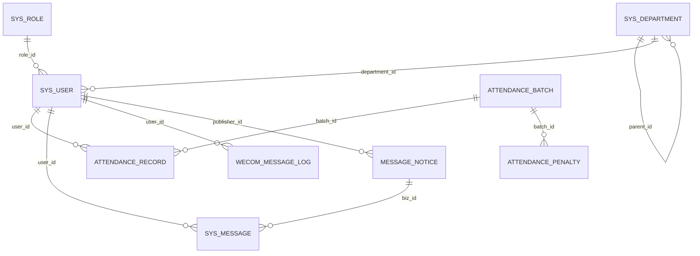

# 数据模型

本文档是数据库的权威说明. 修改表结构时必须同步更新本文件.

## 1. ER 图



说明:

- `sys_message.biz_id` 是逻辑关联, 不是外键. 通知消息指向 `message_notice.id`, 考勤消息指向 `attendance_batch.id`.
- 没有物理外键约束, 由应用层保证一致性.

## 2. 表清单

| 表 | 作用 |
|---|---|
| `sys_department` | 部门树 |
| `sys_role` | 角色和菜单权限 |
| `sys_user` | 用户, 登录信息, 锁定状态 |
| `attendance_batch` | 月度考勤批次 |
| `attendance_record` | 员工考勤明细 |
| `attendance_penalty` | 考勤异常/处罚明细 |
| `message_notice` | 管理员发布的通知 |
| `notice_template` | 通知模板 |
| `sys_message` | 员工站内消息 |
| `wecom_message_log` | 企业微信发送日志 |

## 3. sys_department

| 字段 | 类型 | 允许空 | 键 | 说明 |
|---|---|---|---|---|
| id | BIGINT | 否 | PK | 自增 |
| code | VARCHAR(10) | 否 | UNIQUE | 10 位部门编码, 每级 2 位 |
| name | VARCHAR(100) | 否 | | 部门名称, 同级唯一 |
| parent_id | BIGINT | 是 | IDX | 上级部门, 空表示一级 |
| level | INT | 否 | | 1-5 |
| status | VARCHAR(20) | 否 | | ACTIVE / DELETED |
| sort | INT | 是 | | 排序 |
| created_at | TIMESTAMP | 是 | | |
| updated_at | TIMESTAMP | 是 | | |

约束:

- 最多 5 级. 原需求写 6 级, 但 10 位编码每级 2 位只能支持 5 级, 这里按 5 级实现.
- 删除是逻辑删除 `status=DELETED`.
- 删除前必须没有有效子部门和有效用户.

## 4. sys_role

| 字段 | 类型 | 允许空 | 键 | 说明 |
|---|---|---|---|---|
| id | BIGINT | 否 | PK | |
| code | VARCHAR(50) | 否 | UNIQUE | ADMIN / HR / EMPLOYEE |
| name | VARCHAR(100) | 否 | | 角色名称 |
| permissions | TEXT | 是 | | 逗号分隔的菜单 code |
| status | VARCHAR(20) | 否 | | ACTIVE / DISABLED |
| created_at | TIMESTAMP | 是 | | |

菜单 code:

```text
dashboard
my-attendance
my-messages
profile
admin-attendance
admin-notice
admin-template
admin-dept
admin-role
admin-user
```

`permissions` 为 `*` 表示全部菜单.

## 5. sys_user

| 字段 | 类型 | 允许空 | 键 | 说明 |
|---|---|---|---|---|
| id | BIGINT | 否 | PK | |
| employee_no | VARCHAR(32) | 否 | UNIQUE | 工号, 数字 |
| password | VARCHAR(100) | 否 | | BCrypt |
| initial_password | VARCHAR(100) | 是 | | 初始密码 BCrypt, 用于校验"新密码不能与初始密码相同" |
| name | VARCHAR(100) | 否 | | 姓名 |
| phone | VARCHAR(32) | 是 | | 手机号 |
| email | VARCHAR(128) | 是 | | 邮箱 |
| wecom_user_id | VARCHAR(64) | 是 | | 企业微信 UserID, 留空时回退工号 |
| department_id | BIGINT | 是 | IDX | 所属部门 |
| role_id | BIGINT | 是 | IDX | 所属角色 |
| status | VARCHAR(20) | 否 | | ACTIVE / DISABLED |
| must_change_password | BOOLEAN | 是 | | 是否强制修改密码 |
| failed_attempts | INT | 是 | | 连续密码错误次数 |
| locked_until | TIMESTAMP | 是 | | 锁定截止时间 |
| created_at | TIMESTAMP | 是 | | |
| updated_at | TIMESTAMP | 是 | | |

规则:

- 工号唯一, 必须为数字.
- 连续 5 次错误锁定 15 分钟.
- 新建用户和被重置密码的用户 `must_change_password=true`.
- 密码规则: 8-50 位, 包含大写/小写/数字, 不含汉字和空格.

## 6. attendance_batch

| 字段 | 类型 | 允许空 | 键 | 说明 |
|---|---|---|---|---|
| id | BIGINT | 否 | PK | |
| batch_year | INT | 否 | IDX | 年份 |
| batch_month | INT | 否 | IDX | 月份 1-12 |
| status | VARCHAR(20) | 否 | | PUBLISHED |
| upload_mode | VARCHAR(20) | 否 | | NEW / OVERWRITE / INCREMENTAL |
| created_by | BIGINT | 是 | | 上传人 |
| created_at | TIMESTAMP | 是 | | |
| published_at | TIMESTAMP | 是 | | |
| latest | BOOLEAN | 是 | | 是否最新批次 |

规则:

- 服务层保证同一 `batch_year + batch_month` 只有一条有效批次.
- `latest=true` 的批次用于员工"我的考勤"和提醒按钮.
- 上传月份不能晚于当前月份.

## 7. attendance_record

| 字段 | 类型 | 允许空 | 键 | 说明 |
|---|---|---|---|---|
| id | BIGINT | 否 | PK | |
| batch_id | BIGINT | 否 | IDX | 批次 |
| employee_no | VARCHAR(32) | 否 | IDX | 工号快照 |
| user_id | BIGINT | 是 | IDX | 用户 |
| name | VARCHAR(100) | 是 | | 姓名快照 |
| department_name | VARCHAR(100) | 是 | | 部门名称快照 |
| status | VARCHAR(20) | 否 | | UNREAD / READ / CONFIRMED |
| signature_image | TEXT | 是 | | 签名 base64 |
| signature_time | TIMESTAMP | 是 | | 签名时间 |
| agree | BOOLEAN | 是 | | 是否勾选同意 |
| data_json | TEXT | 是 | | 完整考勤字段 |
| created_at | TIMESTAMP | 是 | | |
| updated_at | TIMESTAMP | 是 | | |

规则:

- 同一批次内 `employee_no` 逻辑唯一.
- 姓名和部门是导入时的快照, 不随用户资料变化.
- `CONFIRMED` 后再次增量上传, 状态保留.
- `data_json` 是完整字段快照, 不参与查询; 关键字段单独建列.

### data_json 字段

| 分组 | 字段 |
|---|---|
| 基础 | 工号, 姓名, 部门, 计资方式 |
| 出勤 | 工作日缺勤天数, 加点小时数, 加班小时数, 法定节假日加班小时 |
| 计件 | 计资类型变化/计件时应出勤天数 |
| 出勤统计 | 实际出勤天数, 高温天数, 应出勤天数, 已调休天数, 本月年休天数, 当月加班调休小时数 |
| 请假 | 病假天数, 工伤假天数, 福利假天数合计-FL, 福利假天数备注 |
| 入离职 | 入厂之前或离职之后当月工作日天数 |
| 冲抵 | 与加班冲抵后的缺勤天数+FL天数+DA |
| 异常 | 旷工天数, 迟到10分钟含以内, 早退10分钟含以内, 迟到10-30分钟含, 早退10-30分钟含, 迟到30分钟以上, 早退30分钟以上, 个人原因打卡/签到异常次数 |
| 绩效 | 下浮绩效点数(一级), 减少表现奖分数(一级), 下浮绩效点数(其他), 减少表现奖分数(其他) |
| 签字 | 员工本人签字确认 |

## 8. attendance_penalty

| 字段 | 类型 | 允许空 | 键 | 说明 |
|---|---|---|---|---|
| id | BIGINT | 否 | PK | |
| batch_id | BIGINT | 否 | IDX | 批次 |
| import_type | VARCHAR(20) | 是 | | NEW / MODIFY |
| code | VARCHAR(50) | 是 | | 编号 |
| employee_no | VARCHAR(32) | 是 | IDX | 工号 |
| name | VARCHAR(100) | 是 | | 姓名 |
| department_name | VARCHAR(100) | 是 | | 部门 |
| data_json | TEXT | 是 | | 完整异常字段 |
| created_at | TIMESTAMP | 是 | | |

编号规则:

```text
工号 + 两位月份 + 三位流水号
例如: 10003 + 07 + 001 = 1000307001
```

## 9. message_notice

| 字段 | 类型 | 允许空 | 键 | 说明 |
|---|---|---|---|---|
| id | BIGINT | 否 | PK | |
| title | VARCHAR(200) | 否 | | 标题 |
| content | TEXT | 是 | | 内容 |
| target_type | VARCHAR(20) | 否 | | ALL / DEPT / USER |
| target_ids | TEXT | 是 | | 逗号分隔的部门或用户 id |
| publisher_id | BIGINT | 是 | | 发布人 |
| status | VARCHAR(20) | 否 | | PUBLISHED |
| created_at | TIMESTAMP | 是 | | |

## 10. notice_template

| 字段 | 类型 | 允许空 | 键 | 说明 |
|---|---|---|---|---|
| id | BIGINT | 否 | PK | |
| title | VARCHAR(200) | 否 | | 模板标题 |
| content | TEXT | 是 | | 模板内容 |
| status | VARCHAR(20) | 否 | | ACTIVE / DISABLED |
| created_at | TIMESTAMP | 是 | | |

## 11. sys_message

| 字段 | 类型 | 允许空 | 键 | 说明 |
|---|---|---|---|---|
| id | BIGINT | 否 | PK | |
| user_id | BIGINT | 否 | IDX | 接收人 |
| type | VARCHAR(30) | 否 | | 消息类型 |
| title | VARCHAR(200) | 是 | | 标题 |
| content | TEXT | 是 | | 内容 |
| biz_id | BIGINT | 是 | | 业务 id |
| read_flag | BOOLEAN | 是 | IDX | 已读 |
| created_at | TIMESTAMP | 是 | | |

消息类型:

```text
ATTENDANCE          考勤生成
ATTENDANCE_REMIND   考勤提醒
ATTENDANCE_ABNORMAL 考勤异常提醒
NOTICE              系统通知
```

## 11.1 wecom_message_log

| 字段 | 类型 | 允许空 | 键 | 说明 |
|---|---|---|---|---|
| id | BIGINT | 否 | PK | |
| user_id | BIGINT | 是 | IDX | 用户 id |
| employee_no | VARCHAR(32) | 是 | | 工号快照 |
| wecom_user_id | VARCHAR(64) | 是 | | 企业微信 UserID 快照 |
| scene | VARCHAR(32) | 是 | | 消息场景 |
| title | VARCHAR(200) | 是 | | 标题 |
| content | TEXT | 是 | | 内容快照 |
| status | VARCHAR(20) | 否 | | SENT / FAILED / SKIPPED |
| errcode | INT | 是 | | 企业微信错误码 |
| errmsg | VARCHAR(500) | 是 | | 错误信息 |
| created_at | TIMESTAMP | 是 | IDX | |

说明:

- 企业微信异步发送, 失败不影响站内消息
- 未启用企业微信时不写日志
- 用户没有 WeCom UserID 时写 SKIPPED

## 12. 状态枚举

| 枚举 | 值 |
|---|---|
| 用户状态 | ACTIVE, DISABLED |
| 部门状态 | ACTIVE, DELETED |
| 角色状态 | ACTIVE, DISABLED |
| 批次状态 | PUBLISHED |
| 上传方式 | NEW, OVERWRITE, INCREMENTAL |
| 考勤状态 | UNREAD, READ, CONFIRMED |
| 通知目标 | ALL, DEPT, USER |
| 消息类型 | ATTENDANCE, ATTENDANCE_REMIND, ATTENDANCE_ABNORMAL, NOTICE |

## 13. 索引

| 表 | 索引 |
|---|---|
| sys_user | department_id, role_id, employee_no unique |
| sys_department | code unique, parent_id |
| attendance_batch | batch_year + batch_month |
| attendance_record | batch_id, user_id |
| attendance_penalty | batch_id |
| sys_message | user_id + read_flag |

## 14. 种子数据

首次启动 `DataInitializer` 写入:

- 4 个用户: 10001, 10002, 10003, 10004
- 5 个部门: 信息科技部, 人力资源部, 财务部, 研发中心, 人事服务组
- 3 个角色: ADMIN, HR, EMPLOYEE
- 上个月考勤批次和 4 条明细
- 1 条欢迎通知
- 1 个通知模板

初始数据只在 `app.seed.enabled=true` 且 `sys_user` 为空时写入.
生产 profile 默认关闭.

## 15. 变更检查清单

数据库使用 Flyway 版本管理, H2 和 MySQL 各维护一套迁移:

```text
src/main/resources/db/migration/h2/V<version>__<name>.sql
src/main/resources/db/migration/mysql/V<version>__<name>.sql
```

修改数据模型时必须:

1. 新增同版本 H2 和 MySQL 迁移文件
2. 修改 entity
3. 修改 mapper / service
4. 修改 `DataInitializer`
5. 更新本文件
6. 更新 `SESSION-NOTES.md` 中的表说明
7. 增加或更新测试
8. 确认 `MigrationConsistencyTest` 通过
9. 确认 `MySqlSchemaIntegrationTests` 通过

不要修改已应用的迁移文件. 需要变更时新增下一个版本.
